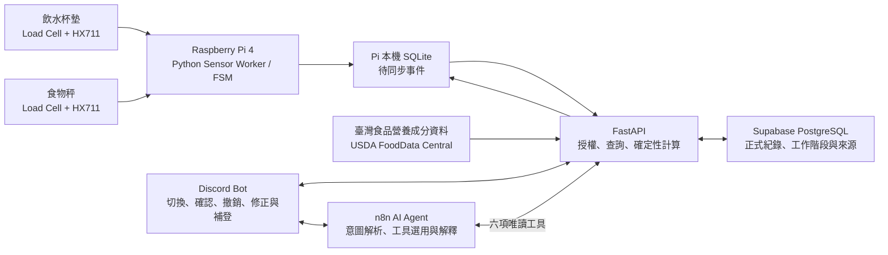

# SmartIntake｜Technical Design v0.5

本文定義 DIC3 已確認的 MVP 規格。原型建置、感測參數定案與 E1–E5 均為規劃中。系統面向實驗室及辦公室固定工作場域，以三位測試使用者與兩台共用秤驗證紀錄流程。

## 系統資料流

Python Sensor Worker 取得量測並產生事件。SQLite 保存待同步事件及其身分快照。FastAPI 以事件識別碼去重並檢查歸屬，收到後端確認後才將該筆事件標為已同步。遇到斷線或重送，同一事件沿用識別碼與原始快照。Supabase PostgreSQL 為正式紀錄及查詢的依據。Discord 人工操作經 FastAPI 寫入，Agent 以獨立唯讀工具介面查詢。

## 五項核心

### C1. Weight Sensing

兩組 Load Cell 與 HX711 各自校正零點及量程。Sensor Worker 分別濾波、偵測穩定重量，並為事件保留裝置識別、量測時間、讀值及校正版本。秤重流程以克（g）為基礎單位。離杯、未穩定、超量程、斷訊或校正異常時，讀值僅供狀態判斷或重測。穩定窗、濾波參數及量程依 E1 與先導測試定案。

### C2. Hydration Event Detection and Logging

| 階段 | FSM 與紀錄行為 |
| --- | --- |
| 杯在位且重量穩定 | 保存拿杯前的基準重量。偵測離杯時開始事件並綁定工作階段。 |
| 杯子離開 | 保存起始時間並等待放回。離杯讀值用於判斷狀態。 |
| 杯子放回並重新穩定 | 以前一穩定重量減去放回後的穩定重量，結合離杯時間與訊號品質評估是否形成飲水候選。 |
| 一般候選 | 依規則自動記錄，標示自動來源，原使用者可事後撤銷或修正。 |
| 異常或不確定候選 | 經 Discord 由原使用者確認、修正或拒絕。未回覆的候選保留待處理狀態，不計入已入帳總量。 |
| 補水或其他可辨識的非飲水事件 | 歸類為非飲水，視訊號更新基準或請使用者確認。 |

重量下降反映質量變化。喝水、倒水及灑出可能留下相同訊號，合乎規則的自動入帳仍是推定紀錄。10 g 最小變化與 120 秒離杯時間為待驗證的初步測試參數。即使低於初步門檻，真實的少量喝水仍納入 E2 真值。場域外飲水由使用者手動補登，並標示手動來源。

後端保存原始重量差與目前有效值。確認、撤銷及修正保留操作者、時間與事件關聯，重複送出同一操作時只套用一次。查詢加總以有效紀錄為準。若介面將重量換算為體積，FastAPI 須保留適用的密度假設、單位與原始質量。

### C3. Multi-User Session Management

三位使用者共用飲水杯墊及食物秤，兩台設備使用同一個 Active User Session。Discord 切換須經 FastAPI 驗證，切換成功後兩台秤的新事件採同一新版本。事件開始時保存 Session ID、User ID 與 Session Version。飲水事件於偵測離杯時綁定，Mode A 於食物秤流程啟動時綁定，Mode B 於餐點紀錄流程啟動時綁定。非秤重的每份參考值流程也沿用原使用者。

切換與事件起始依可確定的順序選取工作階段快照。同步延遲、斷線重送及待確認狀態均沿用原快照。若事件開始時無法確認有效工作階段，系統保留待處理狀態，避免依接收時的使用者自動入帳。Discord 確認以事件原歸屬及已驗證的操作者為準。秤重工作階段與 Agent 查詢的 Discord 請求者身分各自驗證。

### C4. Dietary Logging and Nutrition Estimation

**Mode A — Single Food Weighing**

1. 在 Discord 選擇食物及適用的烹調狀態，啟動食物秤。
2. 放置空容器並執行 Tare，再放入食物取得穩定淨重。
3. 查詢適用的每 100 g 營養資料，優先採臺灣食品營養成分資料庫，必要時以 USDA FoodData Central 補充。
4. FastAPI 依「每 100 g 含量 × 淨重（g）÷ 100」逐項換算，沿用成分單位與資料精度。
5. Discord 顯示實測淨重、來源及營養估算值，由使用者確認後入帳。

**Mode B — Whole-Meal Estimation**

- 便當或混合餐點有可靠淨重及適用的每 100 g 餐點資料時，FastAPI 依實測淨重換算。取得可靠淨重需要已去皮的容器或已知容器重量。
- 外購便當若無法排除餐盒重量，使用有來源的每份參考營養值，並由使用者確認參考份量。包含未知餐盒重量的毛重不得用於淨重計算。
- 條目與餐點不相符或資料缺漏時，顯示缺少的資料並請使用者確認適用來源。營養成分取自可追溯的條目與後端換算，LLM 不補造缺值。

紀錄區分實測淨重、參考份量與營養估算，保留資料庫名稱、條目 ID、版本或取得日期、計算基準、單位及缺值狀態。估算結果的適用性受配方、可食部及烹調狀態影響。資料來源說明見[相關研究](docs/proposal/related-work.md#4-food-composition-databases)。

### C5. Grounded Domain AI Agent

n8n 管理 Tool Calling。LLM 解析問題、選擇授權工具、組織跨日資料及解釋結果。FastAPI 從經驗證的身分決定查詢範圍，驗證查詢參數，執行資料庫查詢、飲水及營養計算，並回傳數值、單位、期間與來源。使用者在提示中提供的帳號資訊不能取代已驗證身分。

| 初期唯讀工具 | 資料用途 |
| --- | --- |
| `get_daily_hydration` | 取得指定日期的飲水紀錄與總量。 |
| `get_hydration_history` | 取得指定期間的飲水紀錄及每日彙整。 |
| `get_food_history` | 取得期間內的飲食紀錄、模式及份量依據。 |
| `get_nutrition_summary` | 依期間彙整可用營養估算值與缺值資訊。 |
| `get_goal_progress` | 依已設定的目標與對應期間紀錄計算進度。 |
| `get_record_sources` | 查詢授權紀錄的量測、補登、修正或成分資料來源。 |

回覆應依結構化資料指出統計期間、數值與來源，保留零值、無紀錄、資料缺漏及查詢失敗的差異。固定排程提醒屬排程自動化，E5 的 Agent 可靠性評估聚焦在工具選擇、授權與解釋。

## 三項技術取捨

| 編號 | 取捨 | 評估方式 |
| --- | --- | --- |
| T1 | Low-Cost Weight Sensing vs. Limited Behavioral Observability | 低成本杯墊取得質量變化，離杯期間的行為證據有限。以 E1 檢查重量品質，以 E2 檢查不同事件能否由現有訊號區分。 |
| T2 | Automation vs. Logging Reliability and Human Confirmation Cost | 一般候選自動入帳，人工處理不確定事件與事後修正。E2 衡量錯記、漏記、修正後表現及確認負擔，E4 比較完整紀錄流程。 |
| T3 | LLM Flexibility vs. Deterministic Calculation and Data Traceability | LLM 保留解讀彈性，數值與權限由固定後端契約管理。E5 逐項檢查工具選擇、數值、來源及缺資料處理。 |

## 十項實作細節

| 編號 | 設計內容 | 主要驗證 |
| --- | --- | --- |
| D01 | 雙 Load Cell 與 HX711，量測來源按裝置保留。 | E1 |
| D02 | 各秤獨立校正、濾波及判定穩定重量。 | E1 |
| D03 | 重量 FSM 以前後穩定重量與離杯狀態評估飲水候選。 | E2 |
| D04 | Discord 通知原使用者確認，並支援撤銷與修正。 | E2、E4 |
| D05 | 使用者選擇食物、完成 Tare 與秤重，FastAPI 確定性換算。 | E4 |
| D06 | 優先採臺灣食品營養成分資料庫，USDA 補充，保存條目與估算依據。 | E4、E5 |
| D07 | 三位使用者共用同一 Active User Session，事件歸屬鎖定在起始快照。 | E3 |
| D08 | FastAPI 查核與計算、Supabase PostgreSQL 保存正式資料、Pi 本機 SQLite 緩衝重送。 | E3、E5 |
| D09 | n8n 使用唯讀 Tool Calling，後端依請求者授權。 | E5 |
| D10 | E1–E5 規劃覆蓋感測、事件、歸屬、效率與 Agent。 | E1–E5 |

## 功能邊界與後續工作

MVP 限於固定工作場域，排除 IMU、Camera、自行訓練的飲水辨識模型、自動食物影像辨識與吸管飲水模式。後續可研究額外感測是否能改善飲水行為的可觀察性，以及多站點是否需要不同的會話管理。原型實作及實驗均待執行。OpenSpec 安裝及 Workflow 轉換暫緩。

參見 [5 Cores、3 Trade-offs、10 Details](docs/proposal/5-cores-3-tradeoffs-10-details.md)與 [E1–E5 實驗計畫](docs/experiments/experiment-plan.md)。
